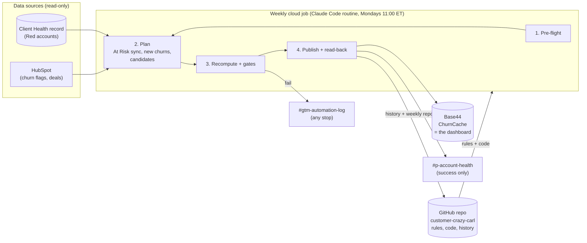

# Churn Analysis Dashboard: how it works

**Audience:** CS/CX leadership and anyone who maintains the refresh. Account managers and CSAs: see the companion guide, [How to read the Churn Analysis dashboard](https://app.notion.com/p/416335d59add81f0936fdf490fc6d3fd).
**Owner:** Will Ritchings (GTM Engineering). **Dashboard:** [Findigs Hub › Churn](https://findigs-growth-hub.base44.app/cx/churn)
**Related:** [Client Health Dashboard: how it works](https://app.notion.com/p/416335d59add81748f99db6050a3b77b) (At Risk on this page comes from there).
**Source of truth:** this page is written from the `customer-crazy-carl` repo (`docs/churn-analysis/`). Every rule it mentions lives in `.claude/skills/churn-analysis-refresh/config.json`; the decision history is `T-tools/02-workflows/churn-analysis-weekly-refresh.md`. Field-level background: Emma Kyber's data dictionary (2026-10-05).

---

## 1. Summary

Every Monday at 11:00 ET, two hours after Client Health, an automated job refreshes the Churn Analysis dashboard. It syncs the **At Risk** list to this week's Client Health Red accounts, adds any **newly churned** customer that passes a strict rule, lists every other possible churn as a *candidate* for a person to review, recomputes every total from the account list, checks its own work, publishes, reads the record back to prove it saved, and posts a one-line summary to `#p-account-health`. If anything is off, it stops before touching the dashboard and posts the step and the error to `#gtm-automation-log` instead.

What it answers: *how much revenue have we lost to churn, why, from which kinds of customers, and how much more is at risk right now?*

**The key design choice:** the account list is a *vetted population*, not a live HubSpot query. HubSpot's churned flag has known false positives (an account cleared in August 2026 was re-flagged), and a July 2026 Salesforce sync reset about 104 flags. So the run never rebuilds the list from HubSpot and never removes a churned account. It only adds what clearly belongs and asks a person about the rest.

---

## 2. Architecture

### Where everything lives

| Component | What it holds | Where |
|---|---|---|
| **Rules and code** | The procedure, every rule (`config.json`: auto-add window, rejected and approved lists, ACV rule, segment and product mapping, reason taxonomy), the scripts | GitHub, private repo `willritchings-findigs/customer-crazy-carl`, `.claude/skills/churn-analysis-refresh/`. Changed only by a reviewed commit. |
| **Run history** | Every run's starting record, plan (with the evidence for each change), record pushed, readback, config used, and the weekly report | Same repo, `O-output/cx-churn-analysis/` |
| **Decision log** | Why each rule exists, incidents, open items | Same repo, `T-tools/02-workflows/churn-analysis-weekly-refresh.md` |
| **The dashboard data** | One record, `churn_overview`: the account list plus every total | Base44 app *Findigs Growth Hub*, entity `ChurnCache` |
| **The job** | Scheduled cloud routine *Churn Analysis Refresh* on the shared Default cloud environment | Claude Code (claude.ai), under Will's account |

### Access the job needs

| System | How it connects | Access level | Credential |
|---|---|---|---|
| HubSpot | Direct API (company search, deals, owners) | Read only | HubSpot private-app key (network secret) |
| Base44 | Direct API | Read the Client Health record; **write** the Churn record (the only write access) | Base44 app token (network secret) |
| Slack | claude.ai connector | Post to `#p-account-health` and `#gtm-automation-log` | Will's connected account |
| GitHub | Built into the routine | Read + commit to `main` | Routine's GitHub access |

**How keys are protected.** Both API keys are *network secrets* on the cloud environment: the proxy attaches each to requests for its one allowed host, so the job never sees a key value. Nothing is stored in the repo. Details: `T-tools/02-workflows/cs-cx-cloud-environment.md`.

---

## 3. Data sources: what we take from each, and why

| Source | What we take | Why |
|---|---|---|
| **HubSpot companies** | `churned` (the checkbox that decides whether an account is churned), churn date (`churn_date`; the Salesforce-era `churn_date__c` only when that is blank), `churn_reason`, account status, segment, Findigs products, go-live date, CSM owner | The system of record for the commercial relationship and the churn decision. |
| **HubSpot deals** | Closed Won deals in the New Logo and Upsell / Expansion pipelines, and their amounts | ACV = the sum of Closed Won deal amounts. HubSpot's `hs_acv` / `hs_arr` / `acv` properties are unused and never populated. |
| **Client Health record** (Base44) | Which accounts are Red this week, their segment and AM; HubSpot IDs from Client Health's own account match | At Risk on this page *means* Client Health Red, so it is read straight from that record rather than re-derived. |
| **Historic sources** (kept, not re-pulled) | Reasons and sub-reasons from Emma's hand-tagged sheet and Sigma's "reason at risk" column, the 2026 FTL review | Set once during the 2026 cleanup; the run never overwrites an existing account's reason. |

---

## 4. The model

### 4.1 Two populations

| Status | Who | Where it comes from |
|---|---|---|
| **Churned** | Customers who have left. Each carries an effective churn date, ACV, segment, product, reason, sub-reasons, reason source, CSM, and whether it was a **Failure to Launch** (`is_ftl`: never went live). | The vetted list, plus new churns that pass the auto-add rule. |
| **At Risk (Client Health Red)** | Current customers whose Client Health composite is Red this week. | Synced every run from the Client Health record. |

An account is never both.

### 4.2 Weekly changes

| Change | Rule |
|---|---|
| **At Risk leaves** | The account is no longer Red in Client Health. Matched by HubSpot company ID first, then exact name. |
| **At Risk joins** | A new Red account. HubSpot ID from Client Health's match (or one exact company-name match). ACV = Closed Won deals summed. If there's no HubSpot match, no Closed Won deal, or more than 2 deals, it joins at **$0 and is flagged**; an approved figure goes in `config.at_risk_acv_overrides`. Segment from Client Health (ENT → STRAT, MM → MM + ENT, SMB → SMB). |
| **New churn, added automatically** | HubSpot says churned with a churn date in the **last 30 days**, and none of these: on the rejected list, account status Live / Onboarding / Pilot, a Closed Won deal dated after the churn date, an unmapped segment, a `churn_reason` outside the taxonomy. |
| **New churn, added by approval** | Any other company whose HubSpot ID Will adds to `config.new_churns.approved_additions`, by commit. |
| **At Risk account churns** | An At Risk account whose HubSpot `churned` checkbox is true is treated like any other churned company (since 2026-11-18): it converts to Churned under the same auto-add rule, or by approval, and its At Risk row is replaced. Until then it stays At Risk and is listed as a candidate marked *on the page as At Risk*. |
| **Churn dates** | Every run re-syncs each churned account's effective churn date to HubSpot's `churn_date` and lists any change in the report (since 2026-11-18). |
| **Everything else** | Listed in the report as a *candidate*, with why it wasn't added. Failure-to-Launch companies not on the page are listed too (propose-only; nothing converts automatically). |
| **Never** | A churned account is never removed, and no account's reason is changed, by the run. |

### 4.3 Reasons

Top-level reasons, in page order: Uncategorized, Dissatisfaction with Product/Service, Merged/Acquired, Tech Stack Consolidation, Leadership Change, Integration, Price, Failure to Launch. Each reason lists the accounts behind it, and most have sub-reasons. An account can carry more than one sub-reason, so sub-reason ACVs can add up to more than their parent reason (known; today in one bucket).

**Reason source** records where each reason came from: HubSpot's churn-reason field, the hand-tagged sheet, Sigma's reason-at-risk column, the old FTL staleness rule, or none. A new auto-added churn takes HubSpot's `churn_reason` if it has one, otherwise *Uncategorized*.

### 4.4 Failure to Launch vs true churn

**FTL** (`is_ftl`) means a churned account that never went live (no go-live date in HubSpot). Since 2026-10-29 (Alex's proposal, Will's sign-off), FTL accounts stay on the page and in every breakdown, but the four headline figures (churned ACV total, YTD, this month, and churned account count) are **true churn only**, so the headline reflects realized revenue loss rather than pilots that never launched. The FTL card is computed live on the page from `is_ftl`. This is broader than the *Failure to Launch* **reason**, which only covers accounts whose churn was attributed to never launching.

### 4.5 The totals

| Field | Definition |
|---|---|
| Churned ACV total / count | True churn (not FTL), all time |
| Churned ACV YTD / this month | True churn with an effective churn date from Jan 1 / the 1st of the month through the run date. **Future-dated churns** (signed notice, contract not yet ended) are excluded and named in the month caption. |
| At Risk count / ACV | All At Risk accounts; the caption says how many ACVs are confirmed by a Closed Won deal and names any that aren't |
| Total ACV tracked | True churn + FTL + At Risk |
| By reason, by product, by segment size, by segment YTD | The full churned population, FTL included. They sum to true churn + FTL, not to the headline count. |
| Reason source coverage | True churn only, by reason source |

Product: DecisionAssist if HubSpot lists DecisionAssist, else Full-Screen if it lists Screening, else Unknown. Segment: HubSpot's STRAT, MM + ENT, SMB; HubSpot's "SMB (<100)" is shown as "SMB (<250)".

---

## 5. Outputs

### What each run produces

| Output | Where | Audience |
|---|---|---|
| Refreshed dashboard | Base44 `churn_overview`, shown on the Churn page | Everyone |
| One-line summary (true churn, YTD, At Risk and its change, new churns, flags) | `#p-account-health` | CX leadership, AMs |
| Weekly report (before/now, every At Risk change with its evidence, new churns, candidates with reasons, FTL candidates, standing data checks, flags, gates) | Repo, `O-output/cx-churn-analysis/<date>_weekly-refresh-report.md` | Will, leadership |
| Full run archive | Repo, `O-output/cx-churn-analysis/history/<date>/` | Audit |
| Failure note (if the run stops) | `#gtm-automation-log`, or a phone push if Slack is down | Will |

### When

Mondays at 11:00 ET; a run takes about 2–3 minutes. If Client Health hasn't refreshed in the last 2 days, the run stops rather than sync At Risk to a stale Red list.

### What changes from week to week, and what doesn't

| Changes every run (data) | Changes only by a reviewed commit (rules) |
|---|---|
| Who is At Risk, and their ACV | The auto-add window and its exclusions |
| New churns that pass the rule | The approved and rejected lists, approved At Risk ACVs |
| Every total, YTD and month figure (they move with the run date) | ACV rule (pipelines, deal-count flag), segment and product mapping |
| The candidate list | The reason taxonomy and page order |

A run never changes a rule, a reason, or a churned account. It may fix a script that fails for a mechanical reason when the fix changes no logic; that fix is committed on its own and posted to `#gtm-automation-log`.

### Safeguards

| Check | What it proves |
|---|---|
| Client Health freshness | The Red list is at most 2 days old. |
| Reproduce first | Recomputing every total from last week's account list reproduces last week's numbers exactly, so the logic and the live record agree before anything changes. |
| Churn only grows | Churned count = last week's + the planned additions; nothing removed. |
| At Risk = Red | At Risk ends up equal to Client Health's Red count (less any Red account already churned). |
| Movement limit | At Risk moves by no more than 8 accounts in one run. |
| No duplicates | No HubSpot company appears twice. |
| Read-back verify | After the push, the record is read back and compared value by value with what was sent; nothing outside the refresh's fields may change. |

---

## 6. How a run works, step by step

1. **Pre-flight.** Confirms Slack answers and the keys resolve; reads the Churn and Client Health records from Base44.
2. **Plan.** Compares At Risk with the Red list; pulls every churned company from HubSpot and the deals of any company it needs an ACV for; applies the auto-add rule; writes the plan with the evidence for every change and every candidate.
3. **Recompute and gate.** Proves the recompute on last week's list, applies the plan, recomputes every total, runs every gate.
4. **Publish.** Pushes, reads back and diffs, archives the run, writes the report, posts the summary.

---

## 7. Open items and known limitations

| Item | Effect today | Status |
|---|---|---|
| 69 companies are churned in HubSpot but not on the page | All churned in 2025 or earlier; unvetted, may include false positives | Listed as candidates every week for a human pass |
| 22 churned accounts show Live / Onboarding / Pilot in HubSpot | May be win-backs or a stale status | Reported every week; needs the deal-level evidence standard used in the 9/24 review |
| ~23% of churned accounts have no product classification | By-product view leans on the classified share | HubSpot data-entry gap |
| Sub-reason ACVs can overlap | Sub-reasons can sum past their parent reason | Display note (Emma's 10/5 builder prompt) not yet pasted |
| Most churns are *Uncategorized* | Reason charts rest on the ~44% (165 of 378) with a recorded reason | New churns take HubSpot's churn reason; older ones need tagging |
| At Risk ACV for accounts with many deals | Joins at $0 until approved | By design (avoids overstating) |
