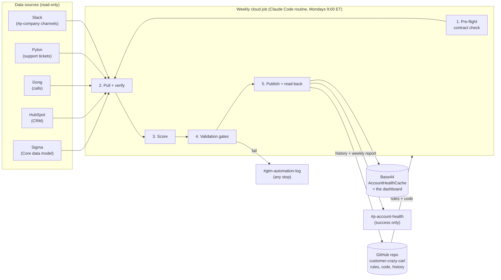

# Client Health Dashboard: how it works

**Audience:** CS/CX leadership and anyone who maintains the refresh. Account managers: see the companion guide, [How to read your Client Health scores](https://app.notion.com/p/416335d59add81a38998ddfdece7cd32).
**Owner:** Will Ritchings (GTM Engineering). **Dashboard:** [Findigs Hub › Client Health](https://findigs-growth-hub.base44.app/cx/client-health)
**Related:** [Customer Health Model — Current State & Known Issues](https://app.notion.com/p/3c6335d59add81f48708e7bc1784e926) (RevOps wiki) · [Client Health: deep reference](https://app.notion.com/p/3fe335d59add8170a957da557382d9b9) (GTM Engineering handoff, Oct 2026; this page supersedes its how-it-runs details).
**Source of truth:** this page is generated from the `customer-crazy-carl` repo (`docs/client-health/`). Every threshold and weight below is read from the same configuration file the refresh runs on, so the page and the job cannot disagree.

---

## 1. Summary

Every Monday at 9:00 ET an automated job rescores every Findigs customer account (267 today) and refreshes the Client Health dashboard. It pulls fresh data from Sigma, HubSpot, Gong, Pylon and Slack, scores each account Green, Yellow or Red across three pillars, checks its own work against a set of validation gates, publishes the results, and posts the week's changes to `#p-account-health`. If anything looks wrong at any step, it stops before changing the dashboard and messages Will instead. The channel only ever sees successful runs.

What it answers for each account: *is the product working for them (Platform), is our relationship with the right people healthy (Strategic), and how do they sound (Sentiment)?*

---

## 2. Architecture

### Where everything lives

| Component | What it holds | Where |
|---|---|---|
| **Rules and code** | The step-by-step procedure, every threshold and weight (`config.json`), the exact Sigma SQL, the scripts | GitHub, private repo `willritchings-findigs/customer-crazy-carl`, folder `.claude/skills/client-health-refresh/`. Changed only by a reviewed commit. |
| **Run history** | Every run's inputs, outputs, the exact config and scripts used, the week-over-week rollup, and the weekly report | Same repo, `O-output/cs-client-health-scoring/` |
| **Decision log** | Why each rule exists, incidents, open items | Same repo, `T-tools/02-workflows/client-health-weekly-refresh.md` |
| **The dashboard data** | One record (`health_overview`) holding all accounts' scores, plus one snapshot record per week (`health_snapshot_<date>`) | Base44 app *Findigs Growth Hub*, entity `AccountHealthCache` |
| **The job** | A scheduled cloud routine, *Client Health Refresh*, running on the shared Default cloud environment | Claude Code (claude.ai), under Will's account |
| **Working files** | Raw pulls during a run | Temporary, inside the run; deleted when it ends (anything kept goes to the repo) |

### Access the job needs

| System | How it connects | Access level | Credential |
|---|---|---|---|
| Sigma | claude.ai connector | Read | Will's connected account |
| HubSpot | Direct API (bulk company pull) + claude.ai connector | Read only | HubSpot private-app key (network secret) |
| Gong | Direct API | Read | Gong API access key (network secret) |
| Pylon | claude.ai connector | Read | Will's connected account |
| Slack | claude.ai connector | Read channels; post to `#p-account-health` and `#gtm-automation-log` | Will's connected account |
| Base44 | Direct API | **Write** (the only write access) | Base44 app token (network secret) |
| GitHub | Built into the routine | Read + commit to `main` | Routine's GitHub access |

**How keys are protected.** The three API keys are stored as *network secrets* on the cloud environment: the cloud proxy attaches each key to requests for its one allowed host, so the job itself never sees a key value, and nothing it reads (a ticket, a Slack message) can trick it into leaking one. Keys are never stored in the repo. Network access is limited to an allowlist (`api.hubapi.com`, `api.gong.io`, `findigs-growth-hub.base44.app` plus defaults). Key owners, scopes and rotation: `T-tools/02-workflows/cs-cx-cloud-environment.md`.

---

## 3. Data sources: what we take from each, and why

Each system is used only for the facts it is the system of record for. Where two systems seem to overlap, they are answering different questions.

| System | What we take | Why this system | What we deliberately don't take from it |
|---|---|---|---|
| **Sigma** (Findigs data warehouse) | Decisions, approvals, decision times, overrides, QA, support-case counts and escalations, application volume, revenue, live units, application funnel, company hierarchy, CSM churn-risk flag | It is the system of record for what actually happens on the platform, at full volume, with history. | Nothing from the CRM: booked units and churn dates come from HubSpot. |
| **HubSpot** (CRM) | Booked units (`total_units_all`), churn status and dates, client-health override, account status, company email domains | It is the system of record for the commercial relationship. Domains are what let us match Gong calls to the right account. | Product usage (Sigma has it at full fidelity). |
| **Gong** (call recordings) | Which accounts we met, call titles (was it a business review?), client attendees' titles (did we meet decision-makers?), call summaries for sentiment | It is the only record of who actually attended our conversations. | Transcripts (summaries are enough). |
| **Pylon** (support desk) | Open property-manager tickets for the account, read for friction | Sigma gives *counts* of cases for the ratio metrics; Pylon is read for the *state and content* of open tickets, which Sigma doesn't carry. Same tickets, different question. | Applicant- and pet-related tickets (not the property manager's experience). |
| **Slack** (`#p-<company>` channels) | What the client and our team are saying, read for sentiment and integration friction | It is where day-to-day account conversation happens. Also used to post alerts. | Anything outside the account's own channel. |
| **Base44** | Last week's record (the starting point and comparison) | It holds the published dashboard. | — |

---

## 4. The scoring model

### 4.1 Which accounts are scored, and how

| Account type | How the overall band is set |
|---|---|
| **DecisionAssist accounts** | The full model below: three pillars of rows, rolled up into one band. |
| **Full-Screen accounts** | The CSM churn-risk flag alone (or the HubSpot client-health override, if set). Platform metrics don't apply to Full-Screen. |
| **Churned accounts** | Excluded from scoring and shown as *Churned*. An account is marked churned when HubSpot says churned (not future-dated, status not Live/Onboarding) **and** it has zero live units and zero activity in 90 days, or when the churn-risk flag reads *Churned* with zero units and zero activity. |

Data window: the trailing 90 days ending on the run date (volume trend also compares the 90 days before that).

### 4.2 The three pillars and their rows

Weights are points within each pillar for each segment; a row's share of its pillar = its weight / the pillar's total for that segment.

<!-- BEGIN GENERATED: scoring_rows -->
#### Platform & Product Metrics (50% of the overall score)

| Row | What it measures | Source | Refreshed | Weight ENT | Weight MM | Weight SMB |
|---|---|---|---|---|---|---|
| Median time to decision | How long applicant groups wait for a screening decision. | Sigma, Groups BI (q1) | Weekly | 6 | 8 | 9 |
| Approval rate | Share of decisioned groups that were approved. | Sigma, Groups BI (q1) | Weekly | 6 | 8 | 9 |
| Decision override rate | How often the property manager overrode Findigs' decision. | Sigma, Groups BI (q1) | Weekly | 11 | 12 | 9 |
| QA rate | Share of decisions that needed a manual QA review. | Sigma, Groups BI (q1) | Weekly | 6 | 6 | 9 |
| Support tickets per 100 decisions | How much support load the property manager generates relative to volume. | Sigma, Support Cases BI (q3) and Groups BI (q1) | Weekly | 10 | 10 | 13 |
| Tech escalation rate | Share of the property manager's support cases escalated to engineering. | Sigma, Support Cases BI (q3) | Weekly | 3 | 3 | 5 |
| Volume trend | Whether application volume is growing or shrinking. | Sigma, Groups BI (q2) | Weekly | 3 | 3 | 6 |
| PMS integration depth | Health of the integration with the property manager's PMS (AppFolio, Yardi, etc.). | Account record (set at review) + Slack scan flag | Frozen (set once; flag refreshed weekly) | 3 | 3 | 3 |

#### Strategic Alignment, Governance & Relationship (30% of the overall score)

| Row | What it measures | Source | Refreshed | Weight ENT | Weight MM | Weight SMB |
|---|---|---|---|---|---|---|
| Business goals documented | Whether the client's business goals for Findigs are written down. | None | No data | 8 | 8 | 9 |
| KPIs defined and tracked | Whether success KPIs are agreed and tracked with the client. | None | No data | 4 | 4 | 2 |
| Performance review cadence | Whether Findigs held a business or performance review with the client. | Gong (call titles), matched to the account by email domain | Weekly when Gong calls match | 5 | 4 | 2 |
| Executive sponsor alignment | Whether Findigs' account team is meeting the client's decision-makers. | Gong (attendee titles), matched to the account by email domain | Weekly when Gong calls match | 6 | 4 | 2 |
| Meeting / touchpoint cadence | Whether Findigs meets the client as often as the segment calls for. | HubSpot meetings and calls (one-time pull, 2026-05-20 to 2026-08-18) | Frozen since 2026-08-18 | 4 | 4 | 2 |
| Multi-threaded relationship | Whether Findigs has relationships with several people at the client, not one. | HubSpot meetings and calls (one-time pull, 2026-05-20 to 2026-08-18) | Frozen since 2026-08-18 | 4 | 3 | 2 |
| CSM churn-risk flag | The account manager's own read of churn risk. | Salesforce churn-risk field via Sigma (Companies BI) / HubSpot churn_risk__c | Weekly | 3 | 2 | 2 |

#### Client Sentiment (20% of the overall score)

| Row | What it measures | Source | Refreshed | Weight ENT | Weight MM | Weight SMB |
|---|---|---|---|---|---|---|
| Client communication sentiment | How the client sounds in recent communication. | Slack #p-<company> channels + Gong call briefs | Weekly | 6 | 6 | 4 |
| Support ticket friction | Whether the client has open, unresolved support friction. | Pylon (open tickets for the account) | Weekly | 5 | 5 | 3 |
| NPS | Net Promoter Score. | None | No data | 4 | 4 | 3 |
<!-- END GENERATED: scoring_rows -->

### 4.3 How rows become an overall band

<!-- BEGIN GENERATED: rollup_rules -->
1. **Each row gets a band** (rules in the metrics library). Rows with no data are skipped, not counted as Red.
2. **Pillar value** = weighted average of row scores, where Green = 100, Yellow = 50, Red = 0, using the segment's row weights above.
3. **Pillar band:** two or more Red rows → Red. Exactly one Red row → Yellow. Otherwise value ≥ 80 → Green, ≥ 60 → Yellow, and below 60 is capped at Yellow (a pillar can't be Red without two Red rows).
4. **Overall value** = pillar values weighted 50 / 30 / 20 (Platform / Strategic / Sentiment), re-weighted over the pillars that have data. Shown for context; the band below does not use it.
5. **Overall band:** two or more Red pillars → Red. One Red pillar → Yellow. All pillars Green → Green. Anything else → Yellow.
6. **Overrides, in order:** a Red CSM churn-risk flag forces Red; then a HubSpot client-health override, if set, replaces the result entirely.
7. **Segments:** weights differ by segment (ENT, MM, SMB). STRAT is scored as ENT.
<!-- END GENERATED: rollup_rules -->

---

## 5. Metrics library

Every metric and row on the dashboard. "Refreshed" says how current the value is; see section 8 for the rows that are not refreshed weekly.

<!-- BEGIN GENERATED: metrics_library -->
| Metric | Definition | Calculation | Unit | Source | Refreshed | Green / Yellow / Red |
|---|---|---|---|---|---|---|
| **Median time to decision** | How long applicant groups wait for a screening decision. | Median hours from submission to decision for groups decisioned in the window, computed separately for approved and declined groups; the worse (higher) of the two is scored. | hours | Sigma, Groups BI (q1) | Weekly | Green < 44 · Yellow ≤ 60 · else Red |
| **Approval rate** | Share of decisioned groups that were approved. | approved / decisioned x 100, groups decisioned in the window. | % | Sigma, Groups BI (q1) | Weekly | Green > 50 · Yellow ≥ 35 · else Red Full-Screen accounts: always Yellow |
| **Decision override rate** | How often the property manager overrode Findigs' decision. | decisioned groups with a decision override / decisioned x 100. Not gated for SMB (always Green). | % | Sigma, Groups BI (q1) | Weekly | ENT: Green ≤ 3 · Yellow ≤ 6 · else Red MM: Green ≤ 3 · Yellow ≤ 6 · else Red SMB: Always Green (not gated) |
| **QA rate** | Share of decisions that needed a manual QA review. | decisioned groups whose workflow status included QA / decisioned x 100. | % | Sigma, Groups BI (q1) | Weekly | Green < 15 · Yellow ≤ 20 · else Red |
| **Support tickets per 100 decisions** | How much support load the property manager generates relative to volume. | property-manager support cases created in the window (Pylon cases; applicant- and guarantor-filed, deleted, and pet tickets excluded) / decisioned groups x 100. | tickets per 100 decisions | Sigma, Support Cases BI (q3) and Groups BI (q1) | Weekly | Green ≤ 15 · Yellow ≤ 50 · else Red |
| **Tech escalation rate** | Share of the property manager's support cases escalated to engineering. | cases with a tech escalation / property-manager cases x 100 (same population as the ticket ratio). | % | Sigma, Support Cases BI (q3) | Weekly | ENT: Green ≤ 3 · Yellow ≤ 6 · else Red MM: Green < 2 · Yellow ≤ 5 · else Red SMB: Green < 2.2 · Yellow ≤ 4 · else Red (provisional) |
| **Volume trend** | Whether application volume is growing or shrinking. | (groups submitted in the window - groups submitted in the equal prior window) / prior window x 100. | % change | Sigma, Groups BI (q2) | Weekly | Green > -20 · Yellow ≥ -40 · else Red Pending: Alex's replacement thresholds |
| **PMS integration depth** | Health of the integration with the property manager's PMS (AppFolio, Yardi, etc.). | Band set from the PMS provider and integration review; a Slack integration-friction signal adds a 'flagged' marker but does not change the band. | band | Account record (set at review) + Slack scan flag | Frozen (set once; flag refreshed weekly) | Band set directly |
| **Business goals documented** | Whether the client's business goals for Findigs are written down. | No data source exists yet; no account has a value, so the row is skipped in scoring. | band | None | No data | — |
| **KPIs defined and tracked** | Whether success KPIs are agreed and tracked with the client. | No data source exists yet; no account has a value, so the row is skipped in scoring. | band | None | No data | — |
| **Performance review cadence** | Whether Findigs held a business or performance review with the client. | Green if a Gong call in the window is titled as a business/exec review; Yellow if there were calls but none was a review. Refreshed only for accounts with matched Gong calls; otherwise the prior band carries forward. | band | Gong (call titles), matched to the account by email domain | Weekly when Gong calls match | Band set directly |
| **Executive sponsor alignment** | Whether Findigs' account team is meeting the client's decision-makers. | Green if at least one client attendee on a Gong call in the window has an exec-level title; Red if there were calls but no client exec. Findigs employees never count. Refreshed only for accounts with matched Gong calls; otherwise the prior band carries forward. | band | Gong (attendee titles), matched to the account by email domain | Weekly when Gong calls match | Band set directly |
| **Meeting / touchpoint cadence** | Whether Findigs meets the client as often as the segment calls for. | Touchpoints logged on the HubSpot company in a 90-day window versus the segment's expected cadence. | band | HubSpot meetings and calls (one-time pull, 2026-05-20 to 2026-08-18) | Frozen since 2026-08-18 | Band set directly |
| **Multi-threaded relationship** | Whether Findigs has relationships with several people at the client, not one. | Distinct client contacts on HubSpot meetings and calls in the same window as touchpoint cadence. | band | HubSpot meetings and calls (one-time pull, 2026-05-20 to 2026-08-18) | Frozen since 2026-08-18 | Band set directly |
| **CSM churn-risk flag** | The account manager's own read of churn risk. | The Churn Risk value (Green / Yellow / Red / Churned) on the account. Red forces the overall band to Red. For Full-Screen accounts it is the whole score. | band | Salesforce churn-risk field via Sigma (Companies BI) / HubSpot churn_risk__c | Weekly | Band set directly |
| **Client communication sentiment** | How the client sounds in recent communication. | The account's Slack #p- channel and Gong call summaries in the window, each classified Positive / Neutral / Negative (Green / Yellow / Red); the more negative of the two wins. Cleared (unscored) when there is no fresh Slack or Gong data. | band | Slack #p-<company> channels + Gong call briefs | Weekly | Band set directly |
| **Support ticket friction** | Whether the client has open, unresolved support friction. | Open property-manager friction tickets created in the window (pet and applicant tickets excluded): 0 = Green, 1-2 = Yellow, 3 or more = Red. Every Red is re-checked against Pylon by an independent reviewer. | band | Pylon (open tickets for the account) | Weekly | Band set directly |
| **NPS** | Net Promoter Score. | No NPS data has ever existed; the row is skipped in scoring. | score | None | No data | — |

**Context fields (shown on the dashboard, never scored)**

| Field | Definition | Unit | Source | Refreshed |
|---|---|---|---|---|
| **Revenue by quarter** | Findigs revenue from the account for each quarter of the year; QoQ compares the last two complete quarters. | $ | Sigma, Revenue Actual BI (q5) | Weekly |
| **Revenue month over month** | Revenue change between two complete calendar months. | % change | Sigma, Revenue Actual BI | Frozen (July vs June 2026) |
| **Median underwriting decision time** | Median underwriting hours across decisioned groups. | hours | Sigma, Groups BI (q1) | Weekly |
| **Live units (this month)** | Units live on Findigs this month, summed across the account's child companies; cross-checked against Unit Counts BI every run. | units | Sigma, Companies BI (q4), checked by Unit Counts BI (gate 6) | Weekly |
| **Units sold (booked)** | Cumulative booked units, New Logo + Expansion (booked, not live). | units | HubSpot company property total_units_all | Weekly |
| **Live vs sold** | Live units / units sold x 100: how much of what was sold is actually live. | % | Sigma + HubSpot | Weekly |
| **Application completion rate** | Applicants who submitted / applicants who started, for people whose first event is in the window (also shows completed applications and funnel total). | % | Sigma, User Application Funnel (PostHog) (q7) | Weekly |
| **Groups submitted vs expected** | Actual groups submitted vs a derived 'expected' benchmark (no real target exists in any system; provisional). | % | Sigma (derived) | Weekly |
| **Account manager / CSA** | Who owns the account. | name | owner_map.json (from the CS Health Score workbook), not HubSpot csm_owner | When the owner map changes |
| **Prior band, weeks red, band history** | Last run's band, consecutive weeks Red, and every run's band for the trend chart. | band / weeks | wow_history.json in the repo | Weekly |
<!-- END GENERATED: metrics_library -->

---

## 6. Outputs

### What each run produces

| Output | Where | Audience |
|---|---|---|
| Rescored dashboard (all accounts) | Base44 `health_overview`, shown on the Client Health page | Everyone |
| Weekly snapshot | Base44 `health_snapshot_<date>` | Trend history |
| Slack posts: header, one alert per account that worsened, kudos per account that improved, one still-Red digest, run summary | `#p-account-health` | AMs, CSAs, leadership |
| Weekly report (band counts, every flip with its reason, CSM flag changes, sentiment findings, churn signals, data notes) | Repo, `O-output/cs-client-health-scoring/<date>_weekly-refresh-report.md` | Will, leadership |
| Full run archive (inputs, outputs, config and scripts used) | Repo, `O-output/cs-client-health-scoring/history/<date>/` | Audit, debugging |
| Failure note (if the run stops) | Post to `#gtm-automation-log`, or a phone push if Slack is down | Will |

<!-- BEGIN GENERATED: alert_rules -->
- **Individual alert** (pings the owner) when an account moves: Green → Yellow, Yellow → Red, Green → Red, new → Red, scored → Churned.
- **Kudos card** when an account improves: Red → Yellow, Yellow → Green, Red → Green.
- **Still Red:** one grouped digest listing every account that stayed Red, with how many weeks; nobody is re-pinged individually.
- Everything posts to #p-account-health, and only after a successful run.
<!-- END GENERATED: alert_rules -->

### When

Mondays at 9:00 ET; a run takes about 30–40 minutes, so results land around 9:30–9:45. A run can also be started by hand at any time.

### What changes from week to week, and what doesn't

| Changes every run (data) | Changes only by a reviewed commit (rules) |
|---|---|
| Every metric value and band, pillar and overall bands, flips and alerts | Thresholds, weights, roll-up rules, segment mapping |
| The 90-day window (it moves with the run date) | The Sigma queries |
| Who is Red and for how many weeks | Which accounts count as pilots for the unit test |
| Sentiment and ticket-friction reads | Gong matching rules (e.g. Findigs staff never count) |
| Account names Sigma renames (added automatically, logged) | Alert rules and the channel |

A run never changes a rule on its own. If last week's bands can't be reproduced with the current rules, the run stops.

### Safeguards

<!-- BEGIN GENERATED: validation -->
Every run must pass all of these before anything is pushed. Any failure stops the run and posts to #gtm-automation-log; nothing reaches the dashboard or the channel.

| Check | What it proves |
|---|---|
| Pre-flight contract check | Credentials resolve; the Base44 record has the expected fields and account count; every Sigma column the queries use exists; every HubSpot property exists. |
| Sigma fingerprint check | Every saved Sigma result matches what Sigma returned (row counts, sums, text fingerprints, each value tied to its account). |
| Threshold reproduction | Re-banding last week's values with the config reproduces last week's bands exactly (catches a changed threshold). |
| Algorithm unit test | 20 pilot accounts' pillars and overall bands reproduce exactly from last week's inputs. |
| Join coverage | Fresh data joins to enough accounts: q1 ≥ 150 accounts, q2 ≥ 150 accounts, q3 ≥ 120 accounts, q7 ≥ 150 accounts. |
| Structural diff | No band (Green / Yellow / Red / Churned) gains or loses more than 25 accounts in one week; every flip is explained. |
| No all-zero metrics | No metric is zero for every account (a sign of a broken query). |
| Unit cross-check | Every account's live units match an independent source (Unit Counts BI). |
| Gong safety stop | Gong matches at least one account and at least 50% of the prior run's matched accounts. |
| Read-back verify | After the push, the record is read back and compared field by field with what was sent. |
<!-- END GENERATED: validation -->

---

## 7. How a run works, step by step

1. **Pre-flight.** Confirms every connector and key works and that Base44, Sigma and HubSpot still look the way the rules expect (fields, columns, properties, account count).
2. **Pull.** Runs the eight Sigma queries exactly as committed and proves each saved result against Sigma; pulls HubSpot companies, Gong calls (and matches them to accounts by email domain, Findigs staff excluded), and reads Pylon and Slack for each account. The Slack, Gong and Pylon reads are done by separate reviewers, and every negative Pylon finding is re-checked independently.
3. **Score.** Applies the rules in section 4 to every account.
4. **Validate.** Every gate in section 6 must pass.
5. **Publish.** Pushes to Base44, reads the record back and compares it field by field, archives the run to the repo, writes the weekly report, then posts to `#p-account-health`.

---

## 8. Open items and known limitations

These affect how much weight a score can bear today. Each is tracked in the decision log.

| Item | Effect today | Status |
|---|---|---|
| *Business goals documented* and *KPIs defined* have no data source | Two of the heaviest Strategic rows are skipped for every account, so Strategic currently rests on review cadence, exec sponsor, meetings, multi-threading and the CSM flag | Needs a data source (e.g. HubSpot fields AMs maintain) |
| *Meeting cadence* and *Multi-threaded relationship* are frozen | Scored from a one-time HubSpot pull (May 20 – Aug 18, 2026); not refreshed weekly | Proposal: refresh weekly from Gong client attendees (with Alex) |
| Exec sponsor counts *any* exec attendee | One exec on one call = Green | Proposal: count distinct client execs, e.g. 2+ for Green (with Alex) |
| Gong-based rows carry forward when no calls match | An account with no matched calls keeps its last band indefinitely (some exec-sponsor bands date from 2026-09-28) | Proposal: expire after N weeks (with Alex) |
| Gong matching is by HubSpot email domain | Accounts without a HubSpot domain (about 30) can't match; parent companies need an alias (Maymont ← Brookfield, Western Wealth ← Western Wealth Capital are set) | Each run lists candidate domains |
| NPS has never had data | The row is skipped | No source |
| Volume-trend thresholds | Flagged as too generous (2026-09-02); no replacement set | Pending Alex |
| SMB tech-escalation thresholds | Marked provisional | Pending review |
| Full-Screen accounts (143 of 267) | Scored on the CSM flag alone | By design |
| Month-over-month revenue | Frozen at July vs June 2026; unscored | Low priority |
