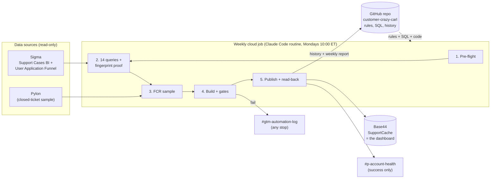

# Support Metrics Dashboard: how it works

**Audience:** CS/CX leadership and anyone who maintains the refresh. Support leads and agents: see the companion guide, [How to read the Support Metrics dashboard](https://app.notion.com/p/416335d59add8127aadbe0906e54446b).
**Owner:** Will Ritchings (GTM Engineering). **Dashboard:** [Findigs Hub › Support Metrics](https://findigs-growth-hub.base44.app/cx/support-metrics)
**Source of truth:** this page is written from the `customer-crazy-carl` repo (`docs/support-metrics/`). Every number, rule and threshold it mentions lives in `.claude/skills/support-metrics-refresh/config.json` and the committed SQL; the decision history is `T-tools/02-workflows/support-metrics-weekly-refresh.md`.

---

## 1. Summary

Every Monday at 10:00 ET an automated job rebuilds the Support Metrics dashboard from the full ticket history, not a sample. It runs 14 fixed queries in Sigma over every Pylon support ticket, proves each saved result against Sigma, samples closed tickets in Pylon for first-contact resolution, checks that every view adds up to the same headline, publishes, reads the record back to prove it saved, and posts a one-line summary to `#p-account-health`. If anything is off, it stops before touching the dashboard and posts the step and the error to `#gtm-automation-log` instead.

What it answers: *how much support demand are we getting and from whom, how fast and how well are we answering it, what are people writing in about, and which tickets are waiting on us right now?*

Until November 2026 these numbers were hand-typed into a push script, refreshed irregularly, and several sections (SLA, FCR, tickets per applicant, friction themes) were weeks or months stale. Since 2026-11-12 every number is recomputed each week from source.

---

## 2. Architecture

### Where everything lives

| Component | What it holds | Where |
|---|---|---|
| **Rules and code** | The procedure, every rule and threshold (`config.json`), the 14 SQL queries, the scripts | GitHub, private repo `willritchings-findigs/customer-crazy-carl`, `.claude/skills/support-metrics-refresh/`. Changed only by a reviewed commit. |
| **Shared SQL rules** | The pet-ticket rule (shared with Client Health), the Pylon base filter, the requester-type (segment) rule | Same repo, `shared/sql/` |
| **Run history** | Every run's saved query results, their fingerprint proofs, the FCR sample, the record pushed, the readback, the config used, and the weekly report | Same repo, `O-output/cx-support-metrics/` |
| **Decision log** | Why each rule exists, incidents, open items | Same repo, `T-tools/02-workflows/support-metrics-weekly-refresh.md` |
| **The dashboard data** | One record, `support_overview` | Base44 app *Findigs Growth Hub*, entity `SupportCache` |
| **The job** | Scheduled cloud routine *Support Metrics Refresh* on the shared Default cloud environment | Claude Code (claude.ai), under Will's account |

### Access the job needs

| System | How it connects | Access level | Credential |
|---|---|---|---|
| Sigma | claude.ai connector | Read | Will's connected account |
| Pylon | claude.ai connector | Read | Will's connected account |
| Slack | claude.ai connector | Post to `#p-account-health` and `#gtm-automation-log` | Will's connected account |
| Base44 | Direct API | **Write** (the only write access) | Base44 app token (network secret) |
| GitHub | Built into the routine | Read + commit to `main` | Routine's GitHub access |

**How keys are protected.** The Base44 key is a *network secret* on the cloud environment: the proxy attaches it to requests for the Base44 host only, so the job never sees the key value. Nothing is stored in the repo. Details: `T-tools/02-workflows/cs-cx-cloud-environment.md`.

---

## 3. Data sources: what we take from each, and why

| System | What we take | Why this system | What we deliberately don't take |
|---|---|---|---|
| **Sigma, Support Cases BI** | Every Pylon ticket: created date, category, sub-category, subject, channel, status, priority, owner, first-response and resolution times, escalation flag, CSAT, requester type, account | Full census with history, one row per ticket, queryable in bulk | Non-Pylon rows, deleted, archived and test tickets |
| **Sigma, User Application Funnel** | People who started an application (first event), by day | The denominator for "tickets per 100 applicants" | Anything else about applications |
| **Pylon** | Six days of closed tickets with their message history (author type, public or private) | The only place that shows how many replies a ticket took. Sigma doesn't carry it. | Message bodies (one character is requested, only to count messages) |
| **Base44** | Last week's record | Week-over-week comparison and the "before" column of the report | — |

---

## 4. How the numbers are defined

### 4.1 Which tickets count

| Rule | Detail |
|---|---|
| **Pylon tickets only** | Not deleted, not archived, not test (`shared/sql/pylon_base.sql`). |
| **Pet tickets are separate** | A ticket is a pet ticket if its sub-category is a pet-verification type, or its category is the pets category with no sub-category, or its subject mentions "pet" (`shared/sql/pet_ticket.sql`, the same rule Client Health uses). Pet tickets are excluded from every figure and get their own **Pet SLA** tile. |
| **Spam is excluded** | Excluded from every figure except the By Category list, where it shows as its own row. So the headline equals the sum of the channel, priority, agent and segment views. |
| **Windows** | 30 days and 7 days ending the day before the run (the run date's partial day is excluded). The trend uses twelve 7-day weeks ending the same day. |

### 4.2 Requester type (segment)

Pylon's requester-type field is free text, so the run buckets it with a pattern rule (`shared/sql/support_segment.sql`): **property manager** (includes landlord, portfolio admin and common misspellings), **applicant** (includes guarantor and misspellings), **unset** (no value: mostly automated or internal mail), and **other** (anything the rule can't place). The run lists the "other" values in its report and stops if they exceed 1% of 30-day volume, so a new requester type is noticed rather than silently mis-bucketed.

### 4.3 The KPI tiles

| Tile | Definition |
|---|---|
| **Ticket volume** | Tickets created in the window, pet and spam excluded; split by property manager and applicant. |
| **Median first response** | Median minutes from creation to first assignment/response (`TICKET_TIME_TO_ASSIGNED_HOURS`). Whole-minute steps, so small shifts move it a full minute. |
| **SLA within target** | Share of **property-manager and applicant** tickets whose first response came within the channel target: chat widget and Slack 2 minutes, email and form 4 hours. A ticket with no first response counts as a miss. Pet and spam excluded; tickets with no requester type left out (mostly automated or internal mail that never gets a reply). |
| **First-contact resolution (FCR)** | Share of closed tickets answered in 2 or fewer public agent replies (Emma's 2026-09-22 definition). A scripted sample, not a census: see 4.4. |
| **PM CSAT / Applicant CSAT** | Average survey score for tickets created in the window. Small 7-day samples; the tile shows n. |
| **Tickets per 100 applicants** | Pet- and spam-excluded tickets ÷ people who started an application in the same window × 100. |
| **Handled without escalation** | Share of tickets with no tech escalation (TES) flag. |
| **Median resolution** | Median minutes from creation to resolution. |
| **Pet SLA** | Share of pet tickets with a first response within 24 hours; no response counts as a miss. Also reports the 4-hour share and the median. |

### 4.4 First-contact resolution sample

Pylon has no bulk "number of replies" field, so each run samples six days of closed tickets (2, 5, 10, 16, 22 and 28 days before the run), up to 100 per day starting 13:00 UTC, and counts **public replies from Findigs users** (system messages and internal notes don't count). Pet and spam tickets are excluded with the same rules as above; tickets closed with no agent reply at all are left out of the rate (they were never answered). The 7-day figure uses the two days inside the last week; the 30-day figure weights all six days equally. About 500 tickets are rated each week.

Expect applicant FCR to run well below property-manager FCR: chat agents often send several short messages in a row, and each one counts as a reply under the definition.

### 4.5 The other sections

| Section | What it shows |
|---|---|
| **By Channel** | 30- and 7-day volume by channel (chat widget, email, form, Slack) with each channel's SLA target. Spam excluded. |
| **By Category** | Volume by Pylon category, in a fixed order. Spam is its own row here. A category the config doesn't know stops the run until it is labelled on purpose. |
| **Friction themes** | For 8 categories, what tickets are about, by keyword rules on the subject line (first match wins). "Other" is the expected long tail. Rules: `config.friction_themes`. |
| **12-week trend** | Weekly volume, median first response, SLA (same rule as the tile), PM and applicant CSAT, tickets per 100 applicants. |
| **Priority and agent breakdowns** | Ticket and open counts by priority and by agent (top 20 named agents; the share chart shows top 10 plus Unassigned and Other), for all tickets and per segment. |
| **By category by segment** | Category volume for property managers and applicants separately, exact census. |
| **Needs Attention** | Up to 50 open property-manager and applicant tickets *waiting on Findigs* (New, Waiting on You, On Engineering, On Customer Success Team), created in the last 90 days, oldest first. Older ones are counted as stale backlog in the report, not listed. Pet and spam excluded. |

---

## 5. Outputs

### What each run produces

| Output | Where | Audience |
|---|---|---|
| Rebuilt dashboard | Base44 `support_overview`, shown on the Support Metrics page | Everyone |
| One-line summary (volume, SLA, FCR, first response, CSAT, Needs Attention) | `#p-account-health` | CX leadership, support leads |
| Weekly report (before/now table, Needs Attention and stale counts, open backlog by status and age, every gate) | Repo, `O-output/cx-support-metrics/<date>_weekly-refresh-report.md` | Will, leadership |
| Full run archive | Repo, `O-output/cx-support-metrics/history/<date>/` | Audit, debugging |
| Failure note (if the run stops) | `#gtm-automation-log`, or a phone push if Slack is down | Will |

### When

Mondays at 10:00 ET, an hour after Client Health; a run takes about 20 minutes. It can also be started by hand.

### What changes from week to week, and what doesn't

| Changes every run (data) | Changes only by a reviewed commit (rules) |
|---|---|
| Every number, tile, chart and list | The 14 SQL queries and the shared pet, base and segment rules |
| The 30-day, 7-day and 12-week windows (they move with the run date) | SLA targets per channel and who counts toward SLA |
| The FCR sample days | The FCR definition and sampling plan |
| Which tickets are in Needs Attention | Needs Attention statuses, age limit and length |
| | Category labels and order, friction keyword rules |

A run never changes a rule. It may fix a script that fails for a mechanical reason (for example a Python-version difference) when the fix changes no logic; that fix is committed on its own and posted to `#gtm-automation-log`.

### Safeguards

Every run must pass all of these before anything is published. Any failure stops the run and posts to `#gtm-automation-log`.

| Check | What it proves |
|---|---|
| Column probes | Every Sigma column the queries use still exists (a zero-row query per table). |
| Fingerprint proof | Every saved query result matches what Sigma returned: row counts, sums, and a text fingerprint that ties each value to its row. A copying mistake can only cause a false stop, never a false pass. |
| One headline | Segments, category × channel (less spam), category × segment, the SLA base, every priority and agent view, and trend week 0 all add up to the same ticket counts. |
| Unknown values | No unlabelled category or channel; unclassified requester types ≤ 1% of volume. |
| Volume sanity | 30-day volume ≥ 5,000 and within ±40% of last week's record. |
| FCR sample | Every planned Pylon page is present and is the call that was planned. |
| Needs Attention | The list length equals min(waiting tickets, 50). |
| Read-back verify | After the push, the record is read back and compared value by value with what was sent; nothing outside the refresh's fields may change. |

---

## 6. How a run works, step by step

1. **Pre-flight.** Confirms Sigma, Pylon and Slack answer, reads last week's record, and probes every Sigma column.
2. **Pull and prove.** Renders the 14 committed queries for the run date, runs each in Sigma exactly as written, saves each result, then has Sigma compute a fingerprint of each result and compares it with the same fingerprint computed from the saved file.
3. **FCR sample.** Makes the six planned Pylon calls and counts agent replies.
4. **Build and gate.** Maps everything onto the dashboard's existing fields (Base44 silently drops unknown field names, so no new fields are ever invented) and runs every gate.
5. **Publish.** Pushes, reads back and diffs, archives the run, writes the report, posts the summary.

---

## 7. Open items and known limitations

| Item | Effect today | Status |
|---|---|---|
| By Channel caption on the page still says spam is included | The caption is wrong; the numbers exclude spam | Needs a Base44 builder prompt (display change) |
| FCR is a sample | ~500 tickets a week; 7-day figure rests on two days | By design (Pylon has no bulk reply count) |
| FCR counts every public message | Chat bursts of several short messages count as several replies, so applicant FCR reads low | Definition is Emma's; could count reply *turns* instead (methodology change, needs sign-off) |
| Friction keyword rules were rebuilt | The original 9/24 rules were never saved; rebuilt under the same theme names | Review with support leads if a theme looks off |
| Stale backlog (open, waiting on Findigs, older than 90 days) | Counted in the report only; the page has no field for it | Would need a new field (builder prompt) |
| CSAT samples are small | 7-day n is often under 20 per segment | Read 7-day CSAT as directional |
